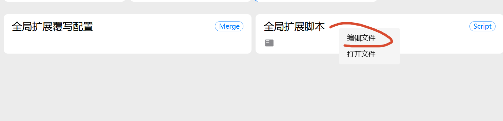

# Clash Setting

⚡ 一个用于 [Clash Verge Rev](https://www.clashverge.dev/guide/quickstart.html) / [Mihomo (Clash Meta)](https://wiki.metacubex.one/) 的 **全局扩展脚本 + 规则集** 仓库，开箱即用。

#### 规则提供者（rule-providers）

- **Loyalsoldier/clash-rules**：https://github.com/Loyalsoldier/clash-rules
- **szkane/ClashRuleSet**: https://github.com/szkane/ClashRuleSet **(转译)**

---

## 快速开始：扩展脚本一键覆盖

> 适用于 Clash Verge Rev（支持扩展脚本功能的客户端）。

1. 打开 **Clash Verge** → **设置** → **扩展脚本**；
2. 将 [Script.js](./Script.js) 的完整内容复制粘贴到脚本编辑器中；
3. **保存**并**重启 Clash 内核**。



> 💡 **提示**：脚本会自动检测配置中是否存在代理 / 代理提供者，若都没有会抛出错误，避免空配置运行。

#### 📦 项目结构

```
clash-setting/
├── Script.js                     # Clash Verge Rev 全局扩展脚本（核心）
├── rules/                        # 规则集目录（共 166 个）
│   ├── *.yaml                    # 根目录 22 个：广告拦截 / 国内直连 / 代理合集
│   ├── Ruleset/                  # 144 个分类规则集（AI / 游戏 / 媒体 / 开发 / 教育…）
│   └── rules-代理规则汇总.md      # 全部规则的分类索引与说明（推荐先读这里）
├── script/                       # 辅助脚本
│   ├── list2yaml.py              # 单个 .list 文件 → payload 格式 .yaml
│   └── batch_list2yaml.py        # 批量递归转换目录下所有 .list
└── assert/image.png              # 扩展脚本配置截图
```

### AI 代理组 filter 自定义

脚本中 AI 分组的 `filter` 字段支持按**国家 Emoji / 国家代码**筛选节点，按需修改：

```js
// 修改为自己想要的国家节点即可（Emoji 与国家代码均可）
"filter": "🇯🇵|🇺🇸",
```

如果需要匹配所有国家的节点，可替换为完整列表：

<details>
<summary>展开查看所有国家 filter</summary>

```js
"filter": "AD|🇦🇩|AE|🇦🇪|AF|🇦🇫|AG|🇦🇬|AL|🇦🇱|AM|🇦🇲|AO|🇦🇴|AR|🇦🇷|AT|🇦🇹|AU|🇦🇺|AZ|🇦🇿|BA|🇧🇦|BB|🇧🇧|BD|🇧🇩|BE|🇧🇪|BF|🇧🇫|BG|🇧🇬|BH|🇧🇭|BI|🇧🇮|BJ|🇧🇯|BN|🇧🇳|BO|🇧🇴|BR|🇧🇷|BS|🇧🇸|BT|🇧🇹|BW|🇧🇼|BZ|🇧🇿|CA|🇨🇦|CD|🇨🇩|CF|🇨🇫|CG|🇨🇬|CH|🇨🇭|CI|🇨🇮|CL|🇨🇱|CM|🇨🇲|CO|🇨🇴|CR|🇨🇷|CV|🇨🇻|CY|🇨🇾|CZ|🇨🇿|DE|🇩🇪|DJ|🇩🇯|DK|🇩🇰|DM|🇩🇲|DO|🇩🇴|DZ|🇩🇿|EC|🇪🇨|EE|🇪🇪|EG|🇪🇬|ER|🇪🇷|ES|🇪🇸|ET|🇪🇹|FI|🇫🇮|FJ|🇫🇯|FM|🇫🇲|FR|🇫🇷|GA|🇬🇦|GB|🇬🇧|GD|🇬🇩|GE|🇬🇪|GH|🇬🇭|GM|🇬🇲|GN|🇬🇳|GQ|🇬🇶|GR|🇬🇷|GT|🇬🇹|GW|🇬🇼|GY|🇬🇾|HN|🇭🇳|HR|🇭🇷|HT|🇭🇹|HU|🇭🇺|ID|🇮🇩|IE|🇮🇪|IL|🇮🇱|IN|🇮🇳|IQ|🇮🇶|IS|🇮🇸|IT|🇮🇹|JM|🇯🇲|JO|🇯🇴|JP|🇯🇵|KE|🇰🇪|KG|🇰🇬|KH|🇰🇭|KI|🇰🇮|KM|🇰🇲|KN|🇰🇳|KR|🇰🇷|KW|🇰🇼|KZ|🇰🇿|LA|🇱🇦|LB|🇱🇧|LC|🇱🇨|LI|🇱🇮|LK|🇱🇰|LR|🇱🇷|LS|🇱🇸|LT|🇱🇹|LU|🇱🇺|LV|🇱🇻|LY|🇱🇾|MA|🇲🇦|MC|🇲🇨|MD|🇲🇩|ME|🇲🇪|MG|🇲🇬|MH|🇲🇭|MK|🇲🇰|ML|🇲🇱|MM|🇲🇲|MN|🇲🇳|MR|🇲🇷|MT|🇲🇹|MU|🇲🇺|MV|🇲🇻|MW|🇲🇼|MX|🇲🇽|MY|🇲🇾|MZ|🇲🇿|NA|🇳🇦|NE|🇳🇪|NG|🇳🇬|NI|🇳🇮|NL|🇳🇱|NO|🇳🇴|NP|🇳🇵|NR|🇳🇷|NZ|🇳🇿|OM|🇴🇲|PA|🇵🇦|PE|🇵🇪|PG|🇵🇬|PH|🇵🇭|PK|🇵🇰|PL|🇵🇱|PS|🇵🇸|PT|🇵🇹|PW|🇵🇼|PY|🇵🇾|QA|🇶🇦|RO|🇷🇴|RS|🇷🇸|RW|🇷🇼|SA|🇸🇦|SB|🇸🇧|SC|🇸🇨|SD|🇸🇩|SE|🇸🇪|SG|🇸🇬|SI|🇸🇮|SK|🇸🇰|SL|🇸🇱|SM|🇸🇲|SN|🇸🇳|SO|🇸🇴|SR|🇸🇷|SS|🇸🇸|ST|🇸🇹|SV|🇸🇻|SZ|🇸🇿|TD|🇹🇩|TG|🇹🇬|TH|🇹🇭|TJ|🇹🇯|TL|🇹🇱|TM|🇹🇲|TN|🇹🇳|TO|🇹🇴|TR|🇹🇷|TT|🇹🇹|TV|🇹🇻|TW|🇹🇼|TZ|🇹🇿|UA|🇺🇦|UG|🇺🇬|US|🇺🇸|UY|🇺🇾|UZ|🇺🇿|VA|🇻🇦|VC|🇻🇨|VN|🇻🇳|VU|🇻🇺|WS|🇼🇸|YE|🇾🇪|ZA|🇿🇦|ZM|🇿🇲|ZW|🇿🇼"
```

</details>=

#### 引用仓库中规则集

```
	"规则集名": {
		...ruleProviderCommon,
		"behavior": "classical",
		"url": "https://cdn.jsdelivr.net/gh/dongge2003/clash-rules-setting@main/规则集位置/***.yaml",
		"path": "./ruleset/dongge2003/规则集名.yaml"
	},
```


> 📖 完整清单与“代理 / 直连”分类说明见 [rules-代理规则汇总.md](./rules/rules-代理规则汇总.md)。

---

## 📚 配置参考资料

- [Clash Verge 官方快速开始](https://www.clashverge.dev/guide/quickstart.html) 
- [Clash Premium 脚本模式](https://clash.wiki/premium/script.html)
- [MetacubeX 规则配置文档](https://wiki.metacubex.one/config/rules/)
- [Loyalsoldier/clash-rules](https://github.com/Loyalsoldier/clash-rules) 
- [szkane/ClashRuleSet](https://github.com/szkane/ClashRuleSet) 

